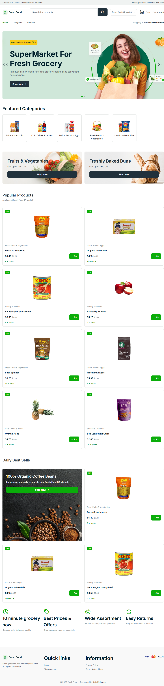
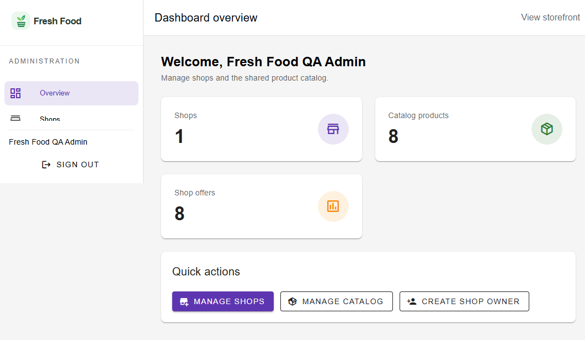

# Fresh Food

Small multi-shop e-commerce management system built for the technical assessment. Fresh Food uses a shared product catalog: administrators and shop owners can create products, shop owners can list catalog products in their assigned shops, and customers only see active products assigned to an active shop.





## Features

### Admin

- Secure admin authentication.
- Shop CRUD with shop-owner assignment.
- Shared catalog category and product CRUD.
- Product image upload through Spatie MediaLibrary.
- Shop-owner account creation, editing, shop assignment, and removal.
- Dashboard summary for shops, catalog products, and shop offers.

### Shop owner

- Role-protected dashboard for assigned shops.
- Browse active products from the shared catalog.
- Add catalog products to an assigned shop.
- Create a new product and list it in the shop; it becomes part of the shared catalog.
- Manage shop-specific price, compare-at price, stock, description, active status, featured status, and thumbnail.
- Product and thumbnail fallback images when an upload is not available.

### Customer storefront

- Browse products for a selected active shop.
- Shop-specific price, stock, description, and thumbnail.
- Search and category filtering.
- Product detail pages and session cart.
- Products not assigned to a shop are never shown.
- Responsive storefront, legal pages, and Fresh Food branding.

Checkout, payment, orders, and delivery management are intentionally outside this assessment scope.

## Technology

- PHP 8.2+
- Laravel 12
- Inertia.js + Vue 3
- Vite, Tailwind CSS, Swiper, and Vuetify
- SQLite by default; MySQL/MariaDB are also supported
- Spatie Laravel Permission for roles
- Spatie Laravel MediaLibrary for product/shop images

## Requirements

Install the following before setup:

- PHP 8.2 or newer with SQLite enabled (or MySQL/MariaDB)
- Composer
- Node.js 20+ and npm
- Git

On Windows, use `npm.cmd` instead of `npm` if PowerShell blocks npm scripts.

## Fresh local installation

These steps are designed for a clean clone and default SQLite setup.

### 1. Clone and enter the project

```bash
git clone https://github.com/Jalismahamud/ecommerce.git
cd ecommerce
```

### 2. Install dependencies

```bash
composer install
npm install
```

Windows PowerShell alternative:

```powershell
composer install
npm.cmd install
```

### 3. Create the environment file

```bash
cp .env.example .env
php artisan key:generate
```

Windows PowerShell:

```powershell
Copy-Item .env.example .env
php artisan key:generate
```

The example file is already configured for SQLite and includes a local demo password in `LIVE_QA_SEED_PASSWORD`. You should change that password for your own environment; it must contain at least 16 characters.

### 4. Create the SQLite database

If you use the default SQLite connection, create the database file before migrating:

```bash
touch database/database.sqlite
```

Windows PowerShell:

```powershell
New-Item -ItemType File -Force database\database.sqlite
```

For MySQL/MariaDB, update `DB_CONNECTION`, `DB_HOST`, `DB_PORT`, `DB_DATABASE`, `DB_USERNAME`, and `DB_PASSWORD` in `.env` instead. Create the empty database in your database server before continuing.

### 5. Run migrations and seed demo data

```bash
php artisan migrate --seed
```

This creates the schema, `admin` and `shop-owner` roles, demo accounts, one demo shop, five categories, eight products, and eight shop offers. The seeder is local-only and idempotent; it does not reset or delete existing data.

### 6. Enable uploaded image URLs

```bash
php artisan storage:link
php artisan optimize:clear
```

### 7. Build frontend assets

```bash
npm run build
```

Windows PowerShell:

```powershell
npm.cmd run build
```

### 8. Start the application

In one terminal:

```bash
php artisan serve
```

Open the URL printed by Laravel, normally `http://127.0.0.1:8000`.

For frontend development with hot reload, use a second terminal:

```bash
npm run dev
```

Windows PowerShell:

```powershell
npm.cmd run dev
```

## Demo accounts

These accounts are created by `php artisan migrate --seed` in the local environment:

| Role | Email | Password |
|---|---|---|
| Admin | `admin@freshfood.test` | Value of `LIVE_QA_SEED_PASSWORD` in `.env` |
| Shop owner | `owner@freshfood.test` | Value of `LIVE_QA_SEED_PASSWORD` in `.env` |

Never use demo credentials in production. To create a separate administrator:

```bash
php artisan app:create-admin-user
```

To rerun the realistic local catalog fixtures later:

```bash
php artisan db:seed --class=Database\\Seeders\\LiveQaSeeder
```

## Application routes

- `/` — customer storefront and active-shop selector
- `/shops/{shop}/{product}` — shop-specific product details
- `/cart` — session cart
- `/privacy-policy` — static privacy policy
- `/terms-and-conditions` — static terms
- `/login` — authentication
- `/dashboard` — role-specific dashboard
- `/admin/shops` — admin shop management
- `/admin/shop-owners` — admin owner management
- `/admin/categories` — admin category management
- `/admin/products` — admin shared catalog management
- `/shop/products` — shop-owner catalog assignment and offer management

## Database design

- `users` stores administrators and shop owners.
- `roles`, `permissions`, and their pivot tables provide role authorization.
- `shops` stores shop information and active status.
- `shop_user` assigns shop owners to shops.
- `categories` stores shared catalog categories.
- `products` stores the shared catalog records.
- `shop_products` stores shop-specific assignment, price, stock, description, visibility, and featured status.
- `media` stores uploaded product, thumbnail, and shop media through Spatie MediaLibrary.

## Validation and tests

Run the backend test suite:

```bash
php artisan test
```

Run PHP formatting checks:

```bash
vendor/bin/pint --test
```

Build the production frontend:

```bash
npm run build
```

The test suite uses an isolated in-memory SQLite database and does not modify the local demo data.

## Troubleshooting

### Login redirects or demo accounts are missing

Confirm `.env` has `APP_ENV=local` and a `LIVE_QA_SEED_PASSWORD` of at least 16 characters, then run:

```bash
php artisan config:clear
php artisan migrate --seed
```

### Images are not visible

Run:

```bash
php artisan storage:link
php artisan optimize:clear
```

Also confirm `APP_URL` matches the URL used to open the app.

### Database errors on a fresh SQLite setup

Confirm that `database/database.sqlite` exists, then run:

```bash
php artisan migrate --seed
```

### PowerShell blocks npm

Use the Windows command shim:

```powershell
npm.cmd install
npm.cmd run build
```

## Project structure

```text
app/
  Http/Controllers/       Admin, auth, dashboard, shop-owner, storefront flows
  Http/Requests/          Form request validation
  Models/                 Shared catalog and shop models
  Policies/               Authorization rules
database/
  migrations/             Application schema
  seeders/                Roles and local demo fixtures
resources/
  js/Pages/               Inertia Vue pages
  js/Layouts/              Storefront and dashboard layouts
  css/                    Application styles
public/frontend/          Supplied grocery theme assets
docs/screenshots/         README screenshots
tests/                    Feature and unit tests
```

## License

This project was created for the Small E-commerce Management technical assessment.
